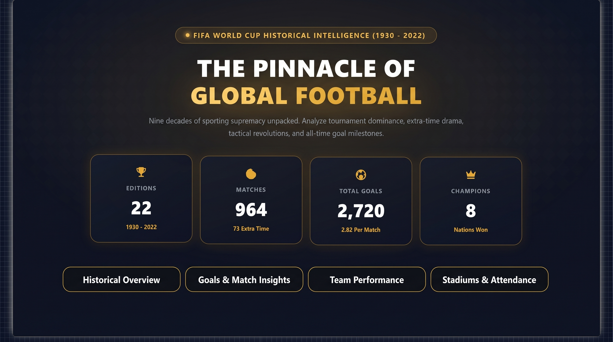
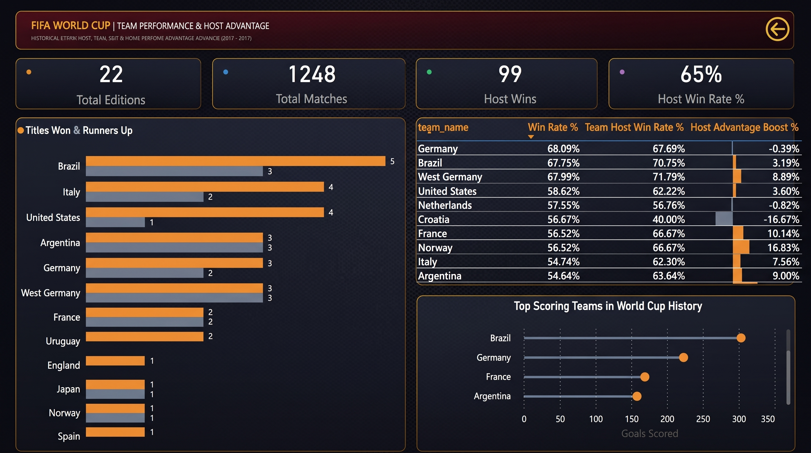
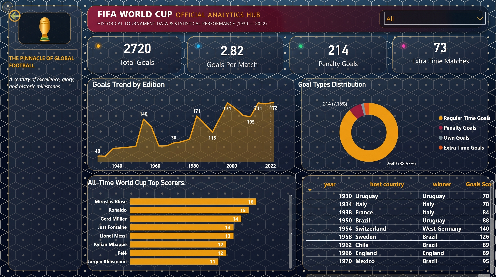
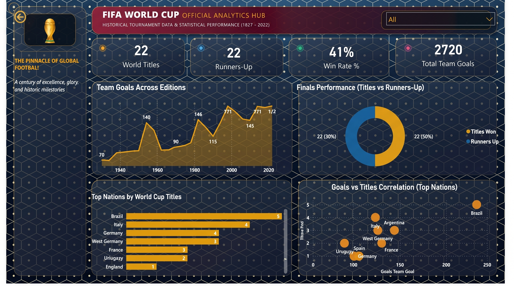
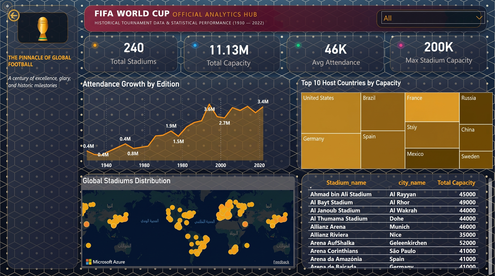
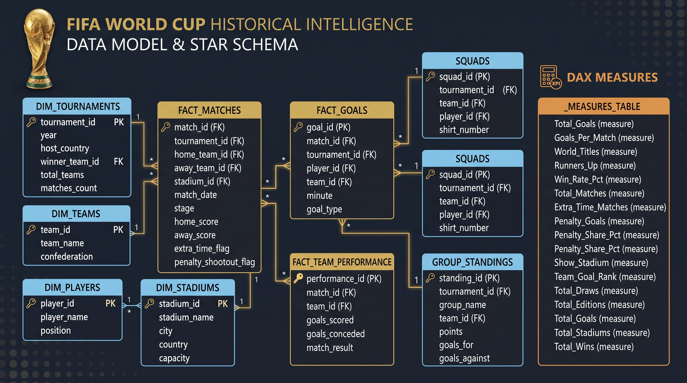

# ⚽ FIFA Men's World Cup (1930 – 2022) — Historical Analytics & Business Intelligence


---

## 📌 Executive Summary
An end-to-end Data Analytics and Business Intelligence project auditing nearly a century of FIFA Men's World Cup history (22 tournaments, 1930–2022). 

The pipeline spans raw data ingestion and ETL preprocessing using **Python (Pandas)**, designing an audited **Star Schema** data model to optimize DAX computations, and engineering a high-impact, interactive multi-page **Power BI Executive Dashboard** with dark modern UI typography.

---

## 📊 Dashboard Showcase

### 1. Landing & Executive KPI Overview
A modern landing page presenting macro-level tournament indicators, historical milestones, and fast navigation to analytical modules.


---

### 2. Historical Overview & Host Advantage Analysis
Deep dive into tournament participation, historical match outcomes, and host nation advantage audit.


---

### 3. Match Dynamics & Goal Scoring Insights
Auditing goal distribution across tournament halves, extra time, penalty shootouts, and scoring trends over time.


---

### 4. Team Performance & Win Rates
Analyzing team dominance, historical titles vs. runners-up conversion, top-scoring nations, and correlation matrices.


---

### 5. Stadiums Distribution & Global Attendance
Tracking attendance escalation per edition, top host nations by capacity, and geographic geospatial stadium distribution using Map visuals.


---

## 🏗️ Data Architecture & Star Schema
To ensure peak DAX performance and eliminate bi-directional ambiguity, the data layer was architected using a pure **Star Schema**:
* **Fact Tables:** Historical match logs, team appearances, and goal records.
* **Dimension Tables:** Tournaments, teams, squads, stadiums, managers, and referees.
* **Filter Propagation:** Strict $1 \to *$ unidirectional relationships preserving filter context integrity.



---

## 📈 Audited Tournament Metrics (1930 – 2022)
| Metric | Audited Value | Note |
| :--- | :--- | :--- |
| **Total Tournaments** | **22 Editions** | 1930 (Uruguay) to 2022 (Qatar) |
| **Total Matches Audited** | **964 Matches** | 73 Extra Time / 35 Penalty Shootouts |
| **Total Goals Scored** | **2,720 Goals** | 2.82 Goals / Match Average |
| **Unique Champions** | **8 Nations** | Brazil (5), Italy (4), Germany (4), etc. |
| **Total Stadiums** | **240 Stadiums** | Across all host continents |
| **Cumulative Attendance** | **40M+** | Peaked in USA 1994 & Qatar 2022 |

---

## 🧮 Sample DAX Calculations
A dedicated `_Measures` table was implemented to isolate analytical logic:

* **Host Advantage Boost:**
```dax
Host Advantage Boost % = 
[Team Host Win Rate %] - [Win Rate %]